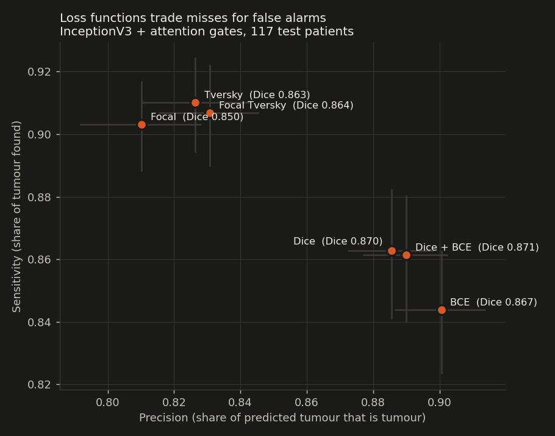
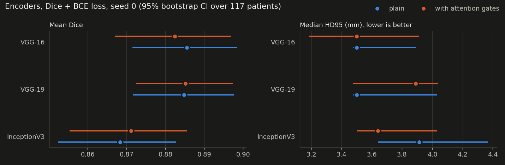
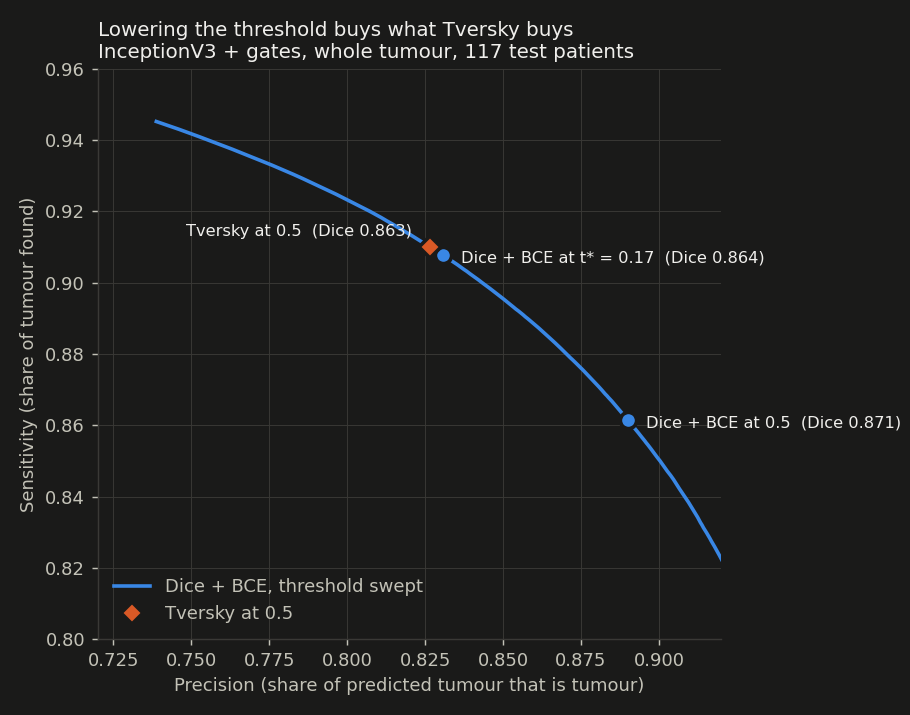
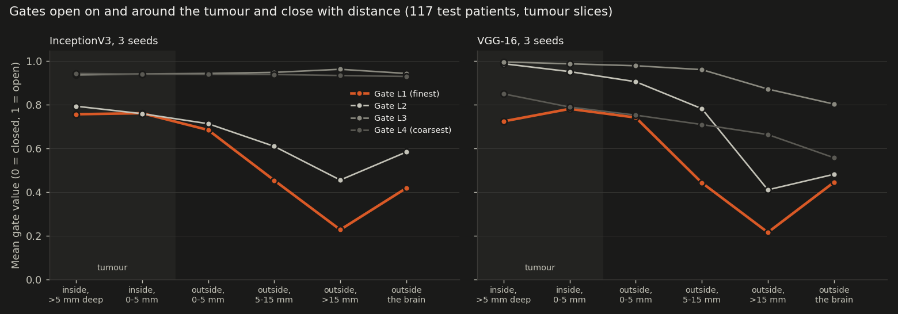
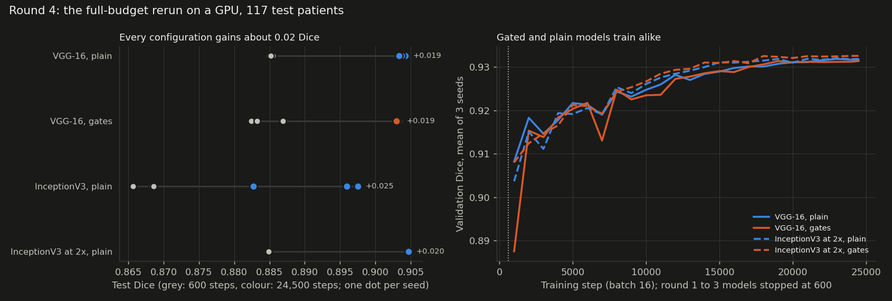
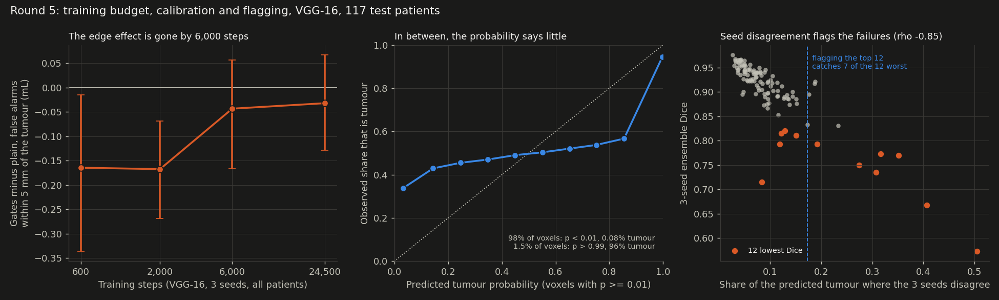
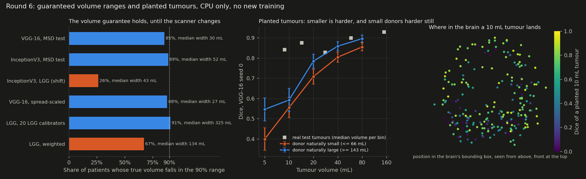

# Brain tumour segmentation: do attention gates and imbalance losses earn their keep?

A 2D U-Net for whole-tumour segmentation on brain MRI (BraTS, via the Medical Segmentation
Decathlon), built three ways (VGG-16, VGG-19 and InceptionV3 encoders), with and without
attention gates, and trained with six loss functions aimed at class imbalance. Every model is
scored per patient in 3D with Dice, IoU, sensitivity, precision and Hausdorff distance, plus
an error breakdown that separates false alarms at the tumour edge from false alarms elsewhere
in the brain.

The usual story is that attention gates "focus the network on the tumour and cut false
positives" and that imbalance losses "fix class imbalance". Both claims were written down as
testable hypotheses in [PREREGISTRATION.md](PREREGISTRATION.md) before any model was trained,
then scored on 117 held-out patients. A second round, also pre-registered, then asked whether
Tversky is just a lower threshold, whether gates help on a harder sub-region or on scans with
the skull left in, and why VGG beat InceptionV3 ([Round 2](#round-2-four-follow-up-questions)).
[Round 3](#round-3-what-the-gates-do-and-a-dataset-shift) looked inside the gates and tested a
shift between datasets, and [Round 4](#round-4-the-full-budget-rerun) reran the main comparisons
with 40 times the training on a GPU. [Round 5](#round-5-budget-less-data-calibration-and-cheap-gains)
traced the gate effect across training budgets and smaller training sets, checked calibration,
tested whether the models can flag their own failures, and tried four cheap accuracy gains.
[Round 6](#round-6-guaranteed-volume-ranges-and-planted-tumours) gave each patient a tumour
volume range with a coverage guarantee, and planted real tumours at different sizes into other
patients' scans to ask why small tumours fail. A [demo page](docs/) shows the models' output
patient by patient.

**In one paragraph:** attention gates never improved Dice. At short training they trimmed false
alarms at the tumour edge, and under a shift between datasets they cut stray false alarms by
10 mL per patient, but the edge effect disappears with full training. Inside the network the
gates act as a spotlight on the tumour region. Tversky and other imbalance losses are a
threshold in disguise. The VGG vs InceptionV3 gap is an input-size effect. Training budget
mattered more than any of these choices. Gates stay within 0.005 Dice of plain models at every
budget and with as little as 10% of the training patients. The models are sharp but not
calibrated in the boundary zone, and disagreement between three seeds is a strong warning sign
for the patients they get wrong. Volume ranges with a 90% guarantee hold on the same dataset
and collapse on a new one. Planted tumours show Dice falling from 0.88 at 80 mL to 0.47 at 5 mL,
and naturally small tumours are harder still at the same size.


*The figure above is deliberately the best case: of the six test patients whose probability
maps were stored, the three slices where the gates removed the most false-alarm area. Red is
false alarm, amber is missed tumour, the white line is the true boundary. On average the
effect is far smaller, as the results below show.*

## Findings

Round 1, at 600 training steps. Rounds 2 to 4 have their own tables below; round 4 overturns
point 2.

| | Pre-registered claim | Verdict |
|---|---|---|
| H1a | Attention gates cut false alarms far (>5 mm) from the tumour | **Not supported** |
| H1b | Attention gates raise Dice by at least 0.01 | **Not supported** |
| H2a | Tversky losses raise sensitivity and lower precision vs Dice+BCE | **Supported** |
| H2b | Plain BCE has the lowest sensitivity of the six losses | **Supported** |
| H3 | Encoders (descriptive only) | VGG beats InceptionV3 by 0.017 Dice |

1. **Attention gates do not improve overlap.** Across three encoders and three InceptionV3
   seeds the Dice change is between -0.003 and +0.003, and its sign flips between seeds of the
   same model. Pooled over the InceptionV3 seeds it is +0.000 [-0.002, +0.002].
2. **What the gates do is shave the tumour edge.** In 4 of 5 matched pairs they cut false
   alarms within 5 mm of the tumour by 0.3 to 0.7 mL per patient (CIs exclude 0), and in 4 of 5
   they raised precision while lowering sensitivity. False alarms far from the tumour, the thing
   attention gates are usually credited with removing, move in both directions. This breakdown
   was not pre-registered.
3. **Imbalance losses are a dial, not an upgrade.** Tversky and focal Tversky find about 5% more
   tumour (sensitivity 0.861 to 0.910) and pay for it in precision (0.890 to 0.826) and Dice.
   Focal loss does the same, harder. Dice+BCE stays the best balanced; no loss beat it on Dice.
4. **Encoder choice matters more than either.** VGG-16 and VGG-19 beat InceptionV3 by 0.017 Dice
   (paired CI [0.011, 0.024]), twice the seed-to-seed spread, and are indistinguishable from
   each other.

## Setup

| | |
|---|---|
| Data | MSD Task01 BrainTumour: 484 BraTS 2016/17 patients, 1 mm isotropic, skull-stripped |
| Inputs | FLAIR, T1gd, T2w (T1w dropped so ImageNet 3-channel stems fit) |
| Target | Whole tumour: oedema, non-enhancing core and enhancing tumour as one class |
| Split | By patient (CRC32 hash): 314 train, 53 validation, 117 test |
| Slices | Axial, z-scored per channel inside the brain, cropped to 224 and resampled to 128 x 128 (1.75 mm pixels); slices under 5% brain dropped. 39,176 train, 14,529 test |
| Model | U-Net decoder on an ImageNet encoder (VGG-16-BN, VGG-19-BN or InceptionV3, cut into 5 stages); optional additive attention gates (Oktay et al. 2018) on all four skips |
| Training | 600 steps of batch 16, AdamW 3e-4, cosine decay, left-right flips and intensity jitter; final weights, no checkpoint picking. Output bias starts at the tumour prior. Round 4: 24,500 steps on a GPU |
| Evaluation | Each test patient's slices are stacked back into a 3D volume and scored at 1 x 1.75 x 1.75 mm |
| Statistics | Per-patient paired differences, 5,000-sample bootstrap 95% CIs, Wilcoxon signed-rank tests |

Losses: BCE, Dice, Dice+BCE, focal (gamma 2, alpha 0.75), Tversky (alpha 0.3, beta 0.7) and
focal Tversky (gamma 0.75). The 15 runs are 3 encoders x {plain, gated} on Dice+BCE, the five
other losses on gated InceptionV3, and two extra seeds of InceptionV3 plain and gated.

## Results

All 15 runs, test set means over 117 patients (HD95 is the median):

| Run | Dice | IoU | Sensitivity | Precision | HD95 (mm) |
|---|---|---|---|---|---|
| VGG-16, plain | **0.885** | **0.802** | 0.882 | 0.898 | 3.50 |
| VGG-16, gates | 0.882 | 0.798 | 0.875 | 0.902 | 3.50 |
| VGG-19, plain | 0.885 | 0.800 | 0.887 | 0.891 | 3.50 |
| VGG-19, gates | 0.885 | 0.800 | 0.882 | 0.896 | 3.89 |
| InceptionV3, plain (3 seeds) | 0.866 to 0.869 | 0.772 to 0.776 | 0.857 to 0.865 | 0.882 to 0.887 | 3.91 |
| InceptionV3, gates (3 seeds) | 0.863 to 0.871 | 0.770 to 0.780 | 0.852 to 0.864 | 0.886 to 0.890 | 3.64 to 3.89 |
| InceptionV3 gates, BCE | 0.867 | 0.773 | 0.844 | **0.901** | 3.91 |
| InceptionV3 gates, Dice | 0.870 | 0.778 | 0.863 | 0.885 | 3.91 |
| InceptionV3 gates, focal | 0.850 | 0.747 | 0.903 | 0.810 | 5.22 |
| InceptionV3 gates, Tversky | 0.863 | 0.765 | **0.910** | 0.826 | 4.61 |
| InceptionV3 gates, focal Tversky | 0.864 | 0.767 | 0.907 | 0.831 | 4.61 |

Full tables with CIs: [results/summary.csv](results/summary.csv),
[results/paired.csv](results/paired.csv), [results/verdicts.md](results/verdicts.md).

### Attention gates (H1a, H1b)


The pre-registered test for H1a used the median per-patient change in distant false-alarm
volume. That median is exactly 0 for every pair, because a quarter to a third of patients have
no distant false alarms with either model. So the right-hand two panels also show the mean,
which was not pre-registered. The mean distant change is -0.11, -0.11, +0.10, +0.08 and -0.00 mL
across the five pairs: no consistent direction. The mean change near the tumour is negative in
4 of 5 pairs, and in 3 of those the missed volume at the edge rises (+0.26 to +0.52 mL), so the
gates are pulling the predicted boundary inward rather than removing stray blobs.

The finest gate map in the top figure shows why the "focus on the tumour" picture is
incomplete: the gates are high on the tumour but also high on the empty space outside the
brain, and low on most normal brain. They learn to pass through what the decoder needs, which
is not the same thing as a tumour detector.

### Loss functions (H2a, H2b)



The six losses fall into two groups. BCE, Dice and Dice+BCE sit together at high precision;
the three losses that up-weight tumour pixels (focal with alpha 0.75, Tversky, focal Tversky)
move about 0.05 up in sensitivity and 0.06 to 0.08 down in precision. Paired against Dice+BCE,
every sensitivity and precision shift for the tumour-weighted losses has a CI well clear of 0,
and they also add 0.4 to 1.5 extra false-alarm blobs of at least 0.1 mL per patient. If missing
tumour is costlier than over-calling it, Tversky is the cheapest way to buy sensitivity: it
gives up less Dice (-0.008) than focal loss (-0.021) for the same gain.

### Encoders (H3)



Paired over patients, VGG-16 beats InceptionV3 by 0.017 Dice [0.011, 0.024] and VGG-19 by 0.016
[0.010, 0.025]; against the InceptionV3 three-seed average the gaps are the same. VGG-19 minus
VGG-16 is -0.001 [-0.004, +0.003]. A likely reason is input size: InceptionV3 was designed for
299 px images and its early stride-2 stem throws away detail on 128 px slices, while VGG keeps
full resolution in its first stage. Round 2 tested this: with 2x upsampled input InceptionV3
matches VGG-16 ([H7](#encoders-again-h7)).

### Seed noise

Retraining InceptionV3 with three seeds moves mean Dice by 0.003 (plain) and 0.008 (gated). By
the pre-registered rule, a single-seed difference smaller than that is not distinguishable from
training noise, whatever its CI says. Every attention-gate Dice effect is inside that band; the
encoder gap and the loss trade-offs are well outside it.


## Round 2: four follow-up questions

Round 1 left four loose ends: is Tversky doing anything a threshold could not, do gates help on a
harder target, do they help on scans that still have the skull and scalp in them, and is the
encoder gap real or a one-seed fluke. Each was written into
[PREREGISTRATION.md](PREREGISTRATION.md) as a dated addendum, with a pass mark, before any round 2
model was trained or scored.

| | Pre-registered claim | Verdict |
|---|---|---|
| H4 | A lower threshold on Dice+BCE buys the same sensitivity as Tversky, at no Dice cost | **Supported** |
| H5a | On enhancing tumour, gates raise Dice by at least 0.01 | **Not supported** |
| H5b | On enhancing tumour, Tversky raises Dice over Dice+BCE | **Not supported** (it lowers it) |
| H6a | On scans with the skull kept, gates cut false alarms far from the tumour | **Not supported** |
| H6b | On scans with the skull kept, gates raise Dice by at least 0.01 | **Not supported** |
| H7a | With three seeds each, VGG-16 beats InceptionV3 on Dice | **Supported** |
| H7b | InceptionV3 fed 2x upsampled input reaches Dice 0.877 | **Supported** (0.885) |

1. **Tversky is a threshold.** Dice+BCE with its threshold lowered to 0.17 lands on the same
   point as Tversky at 0.5, so the extra sensitivity can be bought after training, without a
   second model.
2. **Gates never cut distant false alarms**, not on the harder sub-region and not on scans with
   the skull left in, which is where the "gates stop fat and normal anatomy being called tumour"
   claim should be easiest to see.
3. **The one gate effect that replicates everywhere is a tighter edge**: 0.16 to 0.51 mL fewer
   false alarms within 5 mm of the tumour per patient, in all four settings, every CI below 0.
4. **The encoder gap is about input size.** VGG-16's lead over InceptionV3 survives three seeds,
   but InceptionV3 given 2x upsampled input matches VGG-16 (0.885 vs 0.885).

[results/h4.md](results/h4.md), [results/verdicts_round2.md](results/verdicts_round2.md),
[results/round2_summary.csv](results/round2_summary.csv).

### Threshold or loss? (H4)



Every model outputs a probability, and 0.5 is just a convention. The threshold t* was picked on
the validation set as the point where Dice+BCE's mean sensitivity reaches Tversky's (0.17), then
fixed and applied to the test set:

| 117 test patients | Dice | Sensitivity | Precision | Median HD95 (mm) | Mean distant false alarm (mL) |
|---|---|---|---|---|---|
| Dice+BCE at 0.5 | 0.871 | 0.861 | 0.890 | 3.64 | 0.59 |
| Dice+BCE at 0.17 | 0.864 | 0.908 | 0.831 | 4.37 | 1.16 |
| Tversky at 0.5 | 0.863 | 0.910 | 0.826 | 4.61 | 1.54 |

Paired over patients, Dice+BCE at 0.17 minus Tversky is +0.001 [-0.002, +0.004] Dice, with
sensitivity within 0.003. Tversky at 0.5 sits right on Dice+BCE's own threshold curve. If
anything the threshold is the better route: same sensitivity, fewer far-off false alarms, and
the operating point can be moved again later without retraining. This is one seed of each
model, on the whole tumour.

### Enhancing tumour (H5)

The enhancing part of the tumour is about a fifth of the whole-tumour volume and is scattered
in rims and fragments, so it is both rarer and harder. The same InceptionV3 setup reaches Dice
0.66 to 0.70 on it (4 of 117 test patients have none; they score 1 if the model predicts
nothing and 0 otherwise).

| Enhancing tumour, 117 test patients | Dice | Sensitivity | Precision |
|---|---|---|---|
| Plain, Dice+BCE (2 seeds) | 0.688, 0.694 | 0.789, 0.798 | 0.668, 0.670 |
| Gates, Dice+BCE (2 seeds) | 0.699, 0.700 | 0.781, 0.781 | 0.687, 0.699 |
| Plain, Tversky | 0.659 | 0.842 | 0.589 |
| Gates, Tversky | 0.679 | 0.842 | 0.615 |

Gates minus plain is +0.011 [-0.002, +0.031] with Dice+BCE, +0.020 [+0.007, +0.039] with
Tversky, and +0.008 [-0.002, +0.023] pooled over two Dice+BCE seeds. All three point the same
way and are larger than on the whole tumour (+0.000), but the pre-registered bar (at least 0.01
in all three) is not met. A small gain on the harder target is possible; it is not shown.

Tversky makes things worse here: -0.029 [-0.049, -0.014] Dice without gates and -0.020
[-0.051, +0.009] with them. It still buys sensitivity (+0.05 to +0.06), but on a target this
fragmented it pays more in precision (-0.07 to -0.08) than it gains. The imbalance loss does not
help even where the imbalance is worst.

### Scans with the skull kept (H6)

BraTS is skull-stripped, so round 1 could never test the claim that gates stop scalp fat and
other tissue outside the brain from being called tumour. Round 2 uses the LGG segmentation set
of Buda et al. (2019): 110 lower-grade glioma patients from TCGA with FLAIR and pre- and
post-contrast T1, skull and scalp still in place, and a FLAIR abnormality mask. Split by patient
into 66 train, 11 validation and 33 test. Preprocessing matches round 1 except that each channel
is z-scored over the whole head, as there is no brain mask. The files carry no voxel spacing, so
volumes and distances use a nominal 1.875 x 1.875 x 3 mm voxel.

| Skull kept, 33 test patients | Dice | Sensitivity | Precision | Mean distant false alarm (mL) |
|---|---|---|---|---|
| Plain (3 seeds) | 0.794 to 0.809 | 0.793 to 0.810 | 0.826 to 0.849 | 0.53 to 1.12 |
| Gates (3 seeds) | 0.804 to 0.810 | 0.785 to 0.818 | 0.836 to 0.858 | 0.71 to 0.97 |

Averaged over seeds, gates change distant false alarms by +0.00 mL [-0.12, +0.11] per patient
(-0.02, +0.18 and -0.15 seed by seed) and Dice by +0.004 [-0.001, +0.009]. Neither hypothesis
holds. Two exploratory numbers go the other way from the usual story: edge false alarms drop by
0.51 mL [0.09, 0.97], as before, but the gated models leave more stray blobs of at least 0.1 mL
that touch no tumour (+0.17 per patient [+0.06, +0.28]). With 33 test patients these intervals
are wide, and false alarms inside and outside the brain are not separated (there is no brain
mask to split them with).

### Gates across all settings


Put side by side, the pattern from round 1 holds in every setting: no Dice gain beyond seed
noise, no direction in false alarms far from the tumour, and a consistent cut in false alarms
at the edge. In this setup an attention gate is a boundary-tightening device, not a filter for
normal anatomy. (Round 4 later showed the edge effect is gone after full training; see the
[updated figure](#gates-across-all-settings-with-rounds-3-and-4).)

### Encoders, again (H7)

Round 1 had one VGG-16 seed and guessed that InceptionV3 lost because 128 px slices are too
small for its stride-2 stem. Round 2 adds two more VGG-16 seeds with and without gates, and one
InceptionV3 run whose input is bilinearly upsampled to 256 px before the encoder (the output is
scaled back to 128 px, so scoring is unchanged).

| Whole tumour, 117 test patients | Dice |
|---|---|
| VGG-16 plain, 3 seeds | 0.885, 0.885, 0.885 |
| VGG-16 gates, 3 seeds | 0.882, 0.883, 0.887 |
| InceptionV3 plain, 3 seeds | 0.866 to 0.869 |
| InceptionV3 plain at 2x input | **0.885** |

With three seeds each, VGG-16 beats InceptionV3 by 0.018 [0.013, 0.023] without gates and 0.016
[0.011, 0.022] with them, so the round 1 gap is real. But doubling the input size closes it:
InceptionV3 at 2x gains 0.017 [0.013, 0.020] over its own 1x run and lands level with VGG-16
(-0.001 [-0.007, +0.005], paired against VGG-16 seed 0). The encoder gap was an input-size gap.
The 2x run took about 80 minutes to train against about 2 hours for VGG-16. The 2x result is
one seed.

The extra VGG-16 seeds also recheck H1 on a second encoder: gates minus plain, pooled over
three seeds, is -0.001 [-0.002, +0.000] Dice.

## Round 3: what the gates do, and a dataset shift

Two questions, again written into [PREREGISTRATION.md](PREREGISTRATION.md) before scoring. If
gates tighten the tumour edge, do their maps show it, and does the effect go away when the gates
are switched off? And do gates help when a model trained on skull-stripped scans meets scans with
the skull in?

| | Pre-registered claim | Verdict |
|---|---|---|
| H8a | The finest gate is lower just outside the tumour (0 to 5 mm) than far away (over 15 mm) | **Not supported**: the opposite, in all 6 models |
| H8b | Flattening the gate maps raises false alarms near the tumour | **Not supported** (VGG-16); **uninterpretable** (InceptionV3, Dice fell by 0.10) |
| H9a | Trained on MSD and tested on all 110 LGG patients, gates cut far-off false alarms | **Supported**: -10.4 mL per patient |
| H9b | In the same test, gates raise Dice by at least 0.01 | **Not supported** (+0.002) |

[results/verdicts_round3.md](results/verdicts_round3.md),
[results/gate_profile_summary.csv](results/gate_profile_summary.csv),
[results/ablation_seed0.csv](results/ablation_seed0.csv),
[results/round3_summary.csv](results/round3_summary.csv).

### The gates are a spotlight, not an edge filter (H8)



For each of the six gated models (InceptionV3 and VGG-16, three seeds each, round 1 and 2
weights), every test slice that contains tumour was run through the network and each gate map
was averaged within distance bands around the true boundary. The finest gate (L1, orange) is
open on the tumour and in the first 5 mm around it (about 0.7 to 0.78), and it closes with
distance, down to about 0.22 more than 15 mm away. It opens partly again outside the brain,
where there is nothing for it to hide. Just outside the tumour minus far away is +0.29 to +0.58
per patient in all six models, every CI above 0. The pre-registered guess was the reverse: a
dip just outside the edge, where the boundary false alarms sit. In InceptionV3 the two coarsest
gates stay at about 0.94 everywhere and do almost nothing; VGG-16 uses all four.

The second test switched the gates off at test time by replacing each gate map with its own
per-slice average. That keeps the overall amount of signal passed through but removes the
spatial pattern:

| Gate maps flattened, minus intact, 3 seeds | Edge false alarms (mL) | Far false alarms (mL) | Dice |
|---|---|---|---|
| VGG-16 | -4.53 [-5.09, -3.98] | -0.52 [-0.77, -0.31] | -0.036 [-0.045, -0.029] |
| InceptionV3 | -3.58 [-4.06, -3.12] | -0.33 [-0.51, -0.19] | -0.101 [-0.112, -0.090] |

False alarms fall rather than rise, but only because the predicted tumour shrinks: the tumour
missed at the edge grows by 10 to 12 mL per patient (seed 0). Flattening only the finest gate
does most of the damage in InceptionV3 (-0.106 Dice on seed 0) and the deeper ones almost none;
VGG-16 loses a little at every level. Opening every gate fully costs only 0.006 to 0.007 Dice,
and in VGG-16 it adds about 2 mL of false alarms both near and far from the tumour.

Taken together: the trained networks do lean on their gates, which pass fine detail through
around the tumour and damp it elsewhere. But a network without gates learns to do as well
(round 1), so the spotlight is a route to the same answer, not a better one.

### Trained on one dataset, tested on another (H9)

The round 2 skull-on models were trained on LGG itself. Here the question is the realistic one:
a model trained on clean, skull-stripped BraTS scans meets scans with the skull in. LGG has
pre-contrast T1, FLAIR and post-contrast T1, so six new MSD models were trained on that same
channel set (InceptionV3, with and without gates, three seeds; pre-contrast T1 was streamed out
of the original MSD archive), then run on all 110 LGG patients with the images turned to match
MSD's orientation.

| | Dice | Far false alarms (mL) |
|---|---|---|
| MSD-trained, plain, on all 110 LGG patients (3 seeds) | 0.485 to 0.529 | 36.6 to 49.7 |
| MSD-trained, gates, on all 110 LGG patients (3 seeds) | 0.500 to 0.534 | 30.2 to 36.8 |
| For scale: LGG-trained, on the 33 LGG test patients | 0.79 to 0.81 | 0.5 to 1.1 |

The shift is severe. On the 33 LGG test patients, MSD-trained models score 0.55 against 0.80 for
models trained on LGG, and the reverse direction is as bad (LGG-trained models reach 0.48 to
0.50 on the MSD test set against 0.86). It is not the channel choice: the same models score
0.858 on MSD itself, against 0.868 with round 1's channels. The cause is the scans themselves.
Without a brain mask the 30 to 50 mL of far false alarms per patient cannot be placed, but
skull and scalp, which MSD models have never seen, are the obvious suspects.

Gates cut those far false alarms by 10.4 mL per patient [-12.6, -8.4], with every seed lower
(-8.8, -19.6, -2.9), and edge false alarms by 1.3 mL. Dice does not move (+0.002 [-0.009,
+0.012]): the removed false alarms are a small share of the error. Leaving out the 10 patients
whose T1 channel is a copy of FLAIR in the source data changes neither verdict (-10.2 mL,
+0.005). This is the only place in the project where gates cut false alarms far from the tumour,
and these models trained for 600 steps; round 4 shows why that matters.

## Round 4: the full-budget rerun

Every model so far trained for 600 steps of batch 16, about a quarter of an epoch, because it
ran on a laptop CPU. Round 4 reran the main comparisons with 24,500 steps (10 epochs, about 40
times the budget) on two Kaggle T4 GPUs, with the hypotheses fixed beforehand. The recipe is
otherwise round 1's, with mixed precision; the slice arrays were rebuilt on Kaggle from the same
MSD archive and checked against hashes of the local ones. All 18 runs finished, in 8.5 hours.

| | Pre-registered claim | Verdict |
|---|---|---|
| H10a | Gates raise Dice by at least 0.01 (VGG-16; InceptionV3 at 2x) | **Not supported** (-0.001; +0.001) |
| H10b | Gates cut far false alarms, every seed lower | **Not supported** (-0.06; -0.03 mL, CIs span 0) |
| H10c | Gates cut edge false alarms | **Not supported** (-0.03; -0.04 mL, CIs span 0) |
| H11 | A lower threshold on Dice+BCE buys what Tversky buys | **Supported** |
| H12a | VGG-16 beats InceptionV3 at normal input size | **Supported**: +0.012 [+0.008, +0.016] |
| H12b | InceptionV3 at 2x input closes at least half that gap | **Supported**: 93% |

[results/verdicts_round4.md](results/verdicts_round4.md),
[results/round4_summary.csv](results/round4_summary.csv),
[results/round4_gains.csv](results/round4_gains.csv).



1. **The edge effect was a short-training effect.** The one gate result that held in rounds 1
   and 2, 0.16 to 0.51 mL fewer false alarms at the edge, shrinks to -0.03 and -0.04 mL with
   CIs spanning 0. Validation Dice for gated and plain models tracks closely for the whole run.
   With enough training, gates add nothing measurable on this task.
2. **Threshold still equals Tversky.** For each seed the threshold was picked on validation where
   VGG-16 Dice+BCE reaches Tversky's sensitivity. On the test set Dice+BCE at that threshold
   minus Tversky at 0.5 is +0.001 [-0.001, +0.004] Dice, with sensitivity within 0.001. The
   threshold needed is now 0.020 to 0.027 rather than 0.17: longer training pushes probabilities
   to the extremes, so the operating point moves a long way down.
3. **The encoder gap is still about input size.** VGG-16 scores 0.904, InceptionV3 0.892 at
   normal input and 0.903 at 2x (2x minus VGG-16: -0.001 [-0.004, +0.003]).
4. **Budget beats every design choice.** Every configuration gains 0.014 to 0.030 Dice over its
   600-step version, more than any gate, loss or encoder difference in the project. VGG-16 reaches
   0.904 Dice with median HD95 of 2.7 mm, and the three seeds of each model land within 0.003 of
   each other, with one exception: one InceptionV3 seed at normal input is an outlier (0.883, with 3.3 mL of far false
   alarms against about 0.7 for the rest).

| Full budget, 117 test patients | Dice | Sensitivity | Precision | Median HD95 (mm) |
|---|---|---|---|---|
| VGG-16 plain, 3 seeds | 0.903 to 0.904 | 0.900 to 0.901 | 0.915 to 0.916 | 2.67 to 3.00 |
| VGG-16 gates, 3 seeds | 0.903 | 0.898 to 0.899 | 0.917 | 2.66 to 2.67 |
| VGG-16 plain, Tversky, 3 seeds | 0.897 to 0.898 | 0.930 to 0.935 | 0.871 to 0.877 | 3.40 to 3.47 |
| InceptionV3 plain, 3 seeds | 0.883 to 0.898 | 0.886 to 0.892 | 0.885 to 0.917 | 3.00 to 4.61 |
| InceptionV3 at 2x, plain, 3 seeds | 0.902 to 0.905 | 0.896 to 0.900 | 0.915 to 0.917 | 3.00 |
| InceptionV3 at 2x, gates, 3 seeds | 0.903 to 0.904 | 0.898 to 0.900 | 0.916 to 0.918 | 2.66 to 2.67 |

### Gates across all settings, with rounds 3 and 4


The last three rows are new. Across the whole project, gates never change Dice beyond seed
noise. They trim false alarms at the tumour edge in every 600-step setting, cut false alarms far
from the tumour only under a dataset shift (also at 600 steps), and do neither once the models
are trained properly. Whether the dataset-shift benefit survives full training has not been
tested.

## Round 5: budget, less data, calibration and cheap gains

Round 5 was written down in [PREREGISTRATION.md](PREREGISTRATION.md) on 2026-11-25, before any of
its runs. Everything uses VGG-16 with Dice + BCE and three seeds, on the same 117 test patients.
The new training (27 runs) and the inference pass ran on Kaggle's two T4 GPUs in 8 hours.



| | Pre-registered claim | Verdict |
|---|---|---|
| H13 | Gates and plain models are equivalent within ±0.005 Dice (90% CI) | **Equivalent** in all 4 new settings and in 4 of 7 earlier ones |
| H14 | The edge effect of gates shrinks steadily with training budget | **Not supported**, narrowly: flat to 2,000 steps, then gone |
| H15 | Gates raise Dice by at least 0.01 with 25% or 10% of the patients | **Not supported** at either |
| H16a | The models are overconfident (fitted temperature above 1) | **Not supported**: T = 0.97 |
| H16b | Temperature scaling halves calibration error | **Not supported**: 0.078 to 0.077 |
| H17a | Seed disagreement tracks ensemble Dice (Spearman at most -0.4) | **Supported**: -0.85 [-0.89, -0.78] |
| H17b | The 12 most-disputed patients include at least 6 of the 12 worst | **Supported**: 7 of 12 |
| H18 | Neighbouring slices as input (2.5D) add at least 0.005 Dice | **Not supported**: +0.002 |
| H19a | Averaging with a left-right flipped prediction raises Dice | **Supported**: +0.001 |
| H19b | Removing small predicted blobs raises Dice | **Supported**: +0.002 |
| H19c | A three-seed ensemble beats a single model | **Supported**: +0.002 |

1. **Gates are equivalent to no gates.** At 2,000 and 6,000 training steps, and when trained on
   only 25% (79) or 10% (32) of the training patients, the gates minus plain Dice difference sits
   inside ±0.005 with a 90% CI. The margin was chosen after rounds 1 to 4 were seen, so the
   earlier rows are restatements; the four new settings are real tests. Enhancing tumour, the
   skull-on set and the dataset shift are too noisy at 600 steps to show equivalence.
2. **The edge effect is flat, then gone.** Gates cut edge false alarms by 0.16 mL at 600 steps
   and 0.17 mL at 2,000 (CIs below 0), then by 0.04 and 0.03 mL at 6,000 and 24,500 (CIs span
   0). The pre-registered claim asked for a steady decline, and 2,000 steps is 0.003 mL worse
   than 600, so it fails on the letter. The plain model's own Dice climbs from 0.885 to 0.904
   over the same range: the gates help only while the model is still learning where the edge is.
3. **Less data does not make gates useful.** With 25% of the patients plain Dice drops to 0.886,
   with 10% to 0.863. Gates change it by -0.001 and +0.001.
4. **The models are not overconfident; their middle range is uninformative.** 98% of voxels get
   p below 0.01 and 1.5% get p above 0.99, and those are well calibrated (0.08% and 96%
   tumour). The 0.3% in between are 32 to 67% tumour whatever probability the model gives. One
   temperature cannot fix a flat curve, which is why scaling does nothing. About 5% of all
   tumour voxels sit at p below 0.01, missed with confidence. This explains round 4's low best
   threshold (about 0.02): lowering it recovers some of those. My guess before round 5 had been
   overconfidence, and that was wrong.
5. **Seed disagreement is a good failure flag.** The share of the predicted tumour where three
   seeds disagree needs no ground truth, and it correlates at -0.85 with ensemble Dice. Flagging
   the 12 most-disputed patients (10%) catches 7 of the 12 worst. Part of this is mechanical,
   since disputed voxels are boundary voxels and boundary errors lower Dice, but that is what a
   reviewer would want flagged.
6. **Cheap gains are real but small.** Flip averaging adds 0.001 Dice, dropping predicted blobs
   under 2 mL adds 0.002, and the three-seed ensemble adds 0.002 (0.906, median HD95 2.66 mm).
   The blob cut-off was picked on validation, and 2 mL was the largest value tried for every
   seed, so a larger cut-off might help more. 2.5D input adds 0.002 (0.905 to 0.907 by seed),
   with a CI above 0, but short of the 0.005 that was asked for.
7. **Where the model fails.** Small tumours: the smallest quarter (median 28 mL) averages 0.852
   Dice against about 0.92 for the rest. Several lesions: 0.883 against 0.911 for one. On the
   second dataset, 24 of the 110 LGG patients score below 0.3 Dice with the MSD-trained models,
   mostly small tumours and patients with many far false alarms.

## Round 6: guaranteed volume ranges and planted tumours

Round 6 was written down in [PREREGISTRATION.md](PREREGISTRATION.md) on 2026-11-25, with an
addendum the same day before the planting grid ran. It trains nothing: it reuses the round 3 and
round 4 models and runs on a laptop CPU. It asks two questions. Can the model give each patient a
tumour volume range that is right 90% of the time? And is "small tumours fail" about size
itself, or about the kind of tumour that happens to be small?



| | Pre-registered claim | Verdict |
|---|---|---|
| H20a | 90% volume ranges from VGG-16 cover at least 85% of MSD test patients | **Supported**, narrowly: 85.5% |
| H20b | InceptionV3 ranges hold on MSD test but cover under 80% on the LGG dataset | **Supported**: 88.9% and 26.4% |
| H20c | Recalibrating on 20 LGG patients restores at least 85% coverage | **Supported**: 90.8%, but the ranges are useless (median 325 mL) |
| H20d | Weighted conformal fixes LGG with MSD calibration only | **Not supported**: 67.3% |
| H20e | Scaling the score by seed disagreement keeps coverage and narrows ranges by 10% | **Supported**: 88.0%, 11% narrower |
| H21a | Planted tumours at their own size score like real ones (within 0.05 Dice) | **Supported**: 0.043, over 3 bins |
| H21b | Planted Dice at 5 mL is at least 0.05 below that at 80 mL | **Supported**: 0.342 lower [0.285, 0.402] |
| H21c | Naturally small and naturally large donors score within 0.02 at every size | **Not supported**: small donors lower at all five sizes |

1. **Volume ranges (split conformal prediction).** Each patient's predicted volume (mean of
   three seeds) gets a range sized so that, on 53 validation patients, the true volume falls
   inside it for 90% of them. On the 117 test patients the VGG-16 ranges cover 85.5%, with a
   median width of 30 mL. That passes the 85% bar, but only just. The guarantee assumes test
   patients look like the calibration patients, and the LGG dataset shows what happens when
   they do not: coverage falls to 26%. Recalibrating on 20 LGG patients brings it back to 91%,
   but only by making the ranges so wide (median 325 mL) that they say almost nothing. Weighting
   the MSD calibration patients to look like LGG ones gets to 67%.
2. **Seed disagreement makes the ranges fairer.** Dividing the score by how much the three
   seeds disagree gives confident patients a tighter range and disputed ones a wider one. Coverage
   stays at 88% and the median range is 11% narrower (27 mL).
3. **Planting tumours.** A real tumour from a validation patient is cut out, rescaled, matched
   in brightness to its new surroundings, and blended into a test patient's scan at least 20 mm
   from that patient's own tumour. 1,017 of 1,287 planned tumours found a spot that fits. Planted
   at their own size they score within 0.043 Dice of real tumours of similar volume, so the
   recipe passes its own realism check (though only 3 volume bins had enough plants to compare).
4. **Size itself matters a lot.** The same donor shapes score 0.88 Dice at 80 mL and 0.47 at
   5 mL, averaged over donors. This matters because the test set barely covers small tumours:
   only 7 of the 117 are under 20 mL, so the headline 0.90 Dice says little about them.
5. **But it is not only size.** Donors that were small to begin with score 0.04 to 0.15 lower
   than donors that were large, at every target size, with the biggest gap at 5 mL (0.40 against
   0.55). Small real tumours look different from shrunken large ones, and that difference also
   hurts. A planted 10 mL tumour is missed entirely (Dice under 0.1) 12% of the time, and those
   deeper in the brain score slightly worse (Spearman -0.21).

**Demo.** [docs/](docs/) is a static page for looking at the models' output patient by patient:
six test patients (the two worst, a small tumour done well, a typical one, the largest, and a
bad case the disagreement flag missed) and two planted tumours, with slice-by-slice FLAIR and
T1gd, the true outline, the prediction, where the seeds disagree, Dice, and the 90% volume range.
Everything is precomputed, so it needs no server or model. To open it locally:

```bash
python -m http.server 8781 --directory docs
```

The environment that ran rounds 1 to 3 is pinned in
[requirements-lock.txt](requirements-lock.txt) (Python 3.13.7, CPU PyTorch 2.14.0).

## What this does not show

- **No radiologist in the loop.** The original project refined segmentations with radiologist
  feedback. That cannot be reproduced from a public dataset. The boundary and distant
  error breakdown in [seg/metrics.py](seg/metrics.py) is a stand-in for the kinds of errors a
  reader would flag, not a substitute for one.
- **Fat-tissue false positives only on a small, different dataset.** BraTS is skull-stripped, so
  round 1 could not see scalp fat at all. Round 2's skull-on test (H6) uses a separate 110-patient
  lower-grade glioma set with 33 test patients, nominal voxel sizes, and no brain mask to split
  false alarms inside the brain from those outside it.
- **Most results are short-training results.** Rounds 1 to 3 ran on a laptop CPU at 600 steps of
  batch 16, about a quarter of an epoch. Round 4 showed this matters: the gate edge effect seen
  in every 600-step setting is gone at 24,500 steps. The enhancing-tumour, skull-on, gate-map and
  dataset-shift results (H5, H6, H8, H9) were not rerun at full budget, so they describe
  undertrained models.
- **2D at 128 px.** Even at full budget (0.904 Dice) this is below published 3D BraTS
  whole-tumour results. Attention gates were designed for 3D networks, where the context they
  summarise is larger; that setting was not tested.
- **Some comparisons rest on one seed.** The loss comparisons and the VGG-19 runs are single
  seeds; enhancing tumour has two. Everything in rounds 4 and 5 has three.
- **Failure flagging is tested on one model family.** The disagreement flag in round 5 uses
  three seeds of one VGG-16 setup on one split; how well it transfers to other models or to the
  LGG set was not checked.
- **Planted tumours are not real tumours.** They pass a realism check at their own size, but
  shrinking a tumour to 5 mL is not the same as a tumour that grew to 5 mL, as H21c shows. The
  planting results use one seed of one model, and large plants fit in fewer brains (57 of 117
  at 80 mL), so the 80 mL numbers come from roomier brains.
- **The volume guarantee is on average, not per patient.** Conformal coverage holds over
  patients like the calibration set; on a new scanner or population it broke (26% on LGG).
- **One split.** All MSD results use one patient split; there is no cross-validation.
- **Sub-regions only partly covered.** Round 2 adds enhancing tumour; the tumour core was not
  tried.

## Reproduce

```bash
pip install -r requirements.txt
```

Download `Task01_BrainTumour.tar` (7.6 GB) from the
[Medical Segmentation Decathlon](http://medicaldecathlon.com/) mirror at
`https://msd-for-monai.s3-us-west-2.amazonaws.com/Task01_BrainTumour.tar` into `data/raw/`, then:

```bash
python scripts/prepare_data.py
```

```bash
python scripts/run_grid.py
```

```bash
python scripts/analyze.py
```

```bash
python scripts/figures.py
```

Round 2 needs two more data steps before its queue. `prepare_labels.py` re-reads the label
volumes from the same MSD tar to build enhancing-tumour masks. The skull-on set is the Kaggle
dataset `mateuszbuda/lgg-mri-segmentation`; put its zip at `data/raw/lgg/lgg.zip`. Then:

```bash
python scripts/prepare_labels.py
```

```bash
python scripts/prepare_lgg.py
```

```bash
python scripts/run_round2.py
```

```bash
python scripts/analyze_round2.py
```

`run_round2.py` runs the threshold sweep first (no training), then the 17 round 2 runs, about
16 hours on the same CPU.

Round 3 streams pre-contrast T1 out of the same MSD archive (no full download), trains the six
MSD models on LGG's channel set, scores them on LGG and back, then runs the gate probe (about 12
hours of test-set passes on the CPU):

```bash
python scripts/prepare_t1.py
```

```bash
python scripts/run_round3.py
```

```bash
python scripts/analyze_round3.py
```

Round 4 runs on Kaggle. `scripts/kaggle/prep_kernel.py` is a CPU notebook that rebuilds the
slice arrays from the MSD archive and checks them against `scripts/kaggle/slices.sha256`;
`scripts/kaggle/train_kernel.py` is a two-GPU notebook that takes that output and this code as
inputs, trains the 18 runs in the pre-registered order, and stores per-patient probability
histograms (`scripts/prob_hist.py`) for the threshold test. Put the downloaded `runs/r4_*`
folders into `runs/`, then:

```bash
python scripts/analyze_round4.py
```

Round 5 is `scripts/kaggle/train_kernel5.py`, a second two-GPU notebook that also takes the
round 4 output as input. It first runs `scripts/round5_infer.py` over the three round 4 VGG-16
plain models (flip averaging, blob removal, ensemble, seed disagreement), then the 27 training
runs. Put `runs/r5_*` into `runs/` and its `round5/` folder into `results/round5/`, then:

```bash
python scripts/analyze_round5.py
```

Round 6 runs on CPU from the round 3 and round 4 models. `round6_val.py` scores the validation
patients (the calibration set), `plant.py` runs the planting grid (about 4 hours on 12 threads,
resumable), and `build_demo.py` writes the demo into `docs/`:

```bash
python scripts/round6_val.py
python scripts/plant.py --threads 12
python scripts/analyze_round6.py
python scripts/build_demo.py
```

The exact package versions used are in `requirements-lock.txt`.

`prepare_data.py` streams volumes out of the tar without extracting it and writes about 6 GB of
slice arrays to `data/slices/`. `run_grid.py` trains the 15 runs one after another, skipping
finished ones; each run checkpoints every 25 steps and resumes after a crash or sleep. On an
8-thread CPU an InceptionV3 run takes about 45 minutes and a VGG run 2 to 4 hours. On Windows,
`python scripts/stay_awake.py <pid>` keeps the machine from idle-sleeping while the queue runs.
One configuration can be trained alone:

```bash
python -m seg.train --encoder vgg16 --attention --loss tversky --seed 0
```

Tests (metrics on hand-built volumes, loss behaviour, model shapes, an overfitting check):

```bash
python -m pytest tests
```

## Layout

```
seg/            data loading, models, losses, metrics, training
scripts/        data preparation, run queues, analysis per round, gate probe, figures
scripts/kaggle/ the Kaggle notebooks for rounds 4 and 5 and the slice hashes they check against
tests/          unit tests
results/        summary tables, paired comparisons, verdicts, logs
figures/        README figures
docs/           the static demo page and its precomputed images
runs/<name>/    per-run config, training log, per-patient test metrics
PREREGISTRATION.md
```

Model weights are not committed (125 MB each); rerun the queue to regenerate them.

## History

| When | What |
|---|---|
| December 2023 | Brain MRI tumour classification notebooks (now in [2023-classification/](2023-classification/)) |
| 30 Oct 2026 | Segmentation project started; round 1 pre-registered before any training |
| 30 to 31 Oct 2026 | Round 1: three encoders, attention gates, six losses |
| 31 Oct to 1 Nov 2026 | Round 2: threshold vs loss, enhancing tumour, skull-on scans, input size |
| 2 to 3 Nov 2026 | Rounds 3 and 4: inside the gates, dataset shift, full-budget rerun on Kaggle GPUs |
| 25 Nov 2026 | Round 5: training budget, less data, calibration, failure flagging, cheap gains |
| 25 to 26 Nov 2026 | Round 6: conformal volume ranges, planted tumours, demo page |

Each round's hypotheses were written down before its runs; the dates are in
[PREREGISTRATION.md](PREREGISTRATION.md).

## Earlier work in this repository

[2023-classification/](2023-classification/) holds the original 2023 version of this repository: three Kaggle
notebooks that classify brain MRI slices as glioma, meningioma, pituitary tumour or no tumour,
with a 6-layer CNN, VGG-16 and InceptionV3. That work is classification of whole images; the
project above is pixel-level segmentation and shares no code or data with it.

## References

- Antonelli et al. (2022). The Medical Segmentation Decathlon. *Nature Communications* 13, 4128.
  Data licence CC BY-SA 4.0.
- Menze et al. (2015). The Multimodal Brain Tumor Image Segmentation Benchmark (BRATS). *IEEE TMI* 34(10).
- Oktay et al. (2018). Attention U-Net: Learning Where to Look for the Pancreas. MIDL.
- Salehi, Erdogmus and Gholipour (2017). Tversky loss function for image segmentation using 3D
  fully convolutional deep networks. MLMI.
- Abraham and Khan (2019). A Novel Focal Tversky Loss Function with Improved Attention U-Net for
  Lesion Segmentation. ISBI.
- Lin et al. (2017). Focal Loss for Dense Object Detection. ICCV.
- Angelopoulos and Bates (2023). Conformal Prediction: A Gentle Introduction. *Foundations and
  Trends in Machine Learning* 16(4).
- Tibshirani, Barber, Candes and Ramdas (2019). Conformal Prediction Under Covariate Shift. NeurIPS.
- Buda, Saha and Mazurowski (2019). Association of genomic subtypes of lower-grade gliomas with
  shape features automatically extracted by a deep learning algorithm. *Computers in Biology and
  Medicine* 109. LGG segmentation data licence CC BY-NC-SA 4.0.
