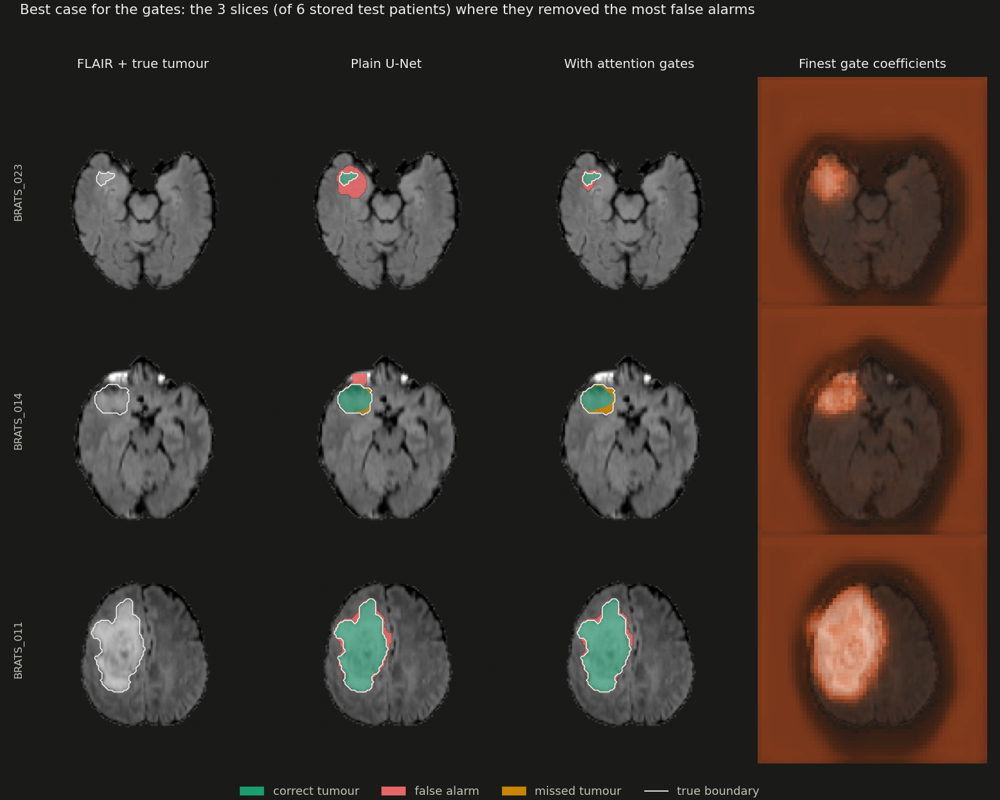
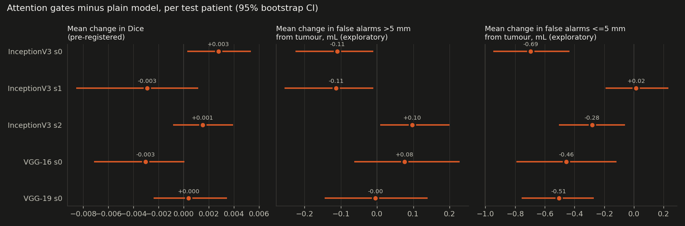
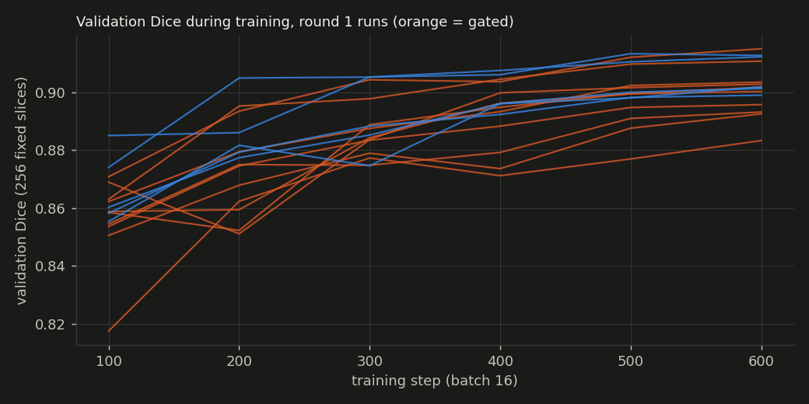
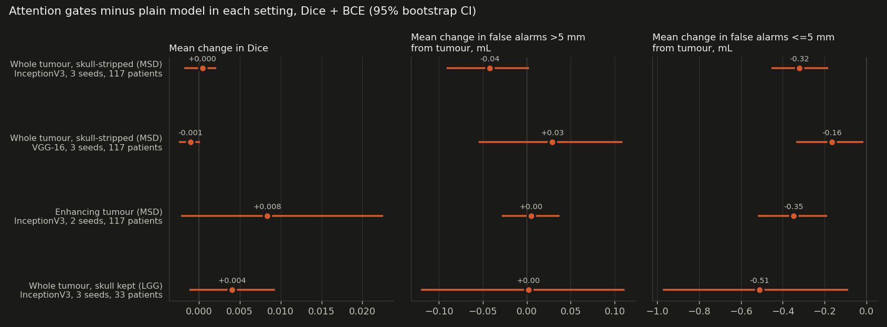

# Brain tumour segmentation: do attention gates and imbalance losses earn their keep?

A 2D U-Net for whole-tumour segmentation on brain MRI (BraTS, via the Medical Segmentation
Decathlon), built three ways (VGG-16, VGG-19 and InceptionV3 encoders), with and without
attention gates, and trained with six loss functions aimed at class imbalance. Every model is
scored per patient in 3D with Dice, IoU, sensitivity, precision and Hausdorff distance, plus
an error breakdown that separates false alarms at the tumour edge from false alarms elsewhere
in the brain.

The usual story is that attention gates "focus the network on the tumour and cut false
positives" and that imbalance losses "fix class imbalance". Both claims were written down as
testable hypotheses in [PREREGISTRATION.md](PREREGISTRATION.md) before any model was trained,
then scored on 117 held-out patients. A second round, also pre-registered, then asked whether
Tversky is just a lower threshold, whether gates help on a harder sub-region or on scans with
the skull left in, and why VGG beat InceptionV3 ([Round 2](#round-2-four-follow-up-questions)).



*The figure above is deliberately the best case: of the six test patients whose probability
maps were stored, the three slices where the gates removed the most false-alarm area. Red is
false alarm, amber is missed tumour, the white line is the true boundary. On average the
effect is far smaller, as the results below show.*

## Findings

| | Pre-registered claim | Verdict |
|---|---|---|
| H1a | Attention gates cut false alarms far (>5 mm) from the tumour | **Not supported** |
| H1b | Attention gates raise Dice by at least 0.01 | **Not supported** |
| H2a | Tversky losses raise sensitivity and lower precision vs Dice+BCE | **Supported** |
| H2b | Plain BCE has the lowest sensitivity of the six losses | **Supported** |
| H3 | Encoders (descriptive only) | VGG beats InceptionV3 by 0.017 Dice |

1. **Attention gates do not improve overlap.** Across three encoders and three InceptionV3
   seeds the Dice change is between -0.003 and +0.003, and its sign flips between seeds of the
   same model. Pooled over the InceptionV3 seeds it is +0.000 [-0.002, +0.002].
2. **What the gates do is shave the tumour edge.** In 4 of 5 matched pairs they cut false
   alarms within 5 mm of the tumour by 0.3 to 0.7 mL per patient (CIs exclude 0), and in 4 of 5
   they raised precision while lowering sensitivity. False alarms far from the tumour, the thing
   attention gates are usually credited with removing, move in both directions. This breakdown
   was not pre-registered.
3. **Imbalance losses are a dial, not an upgrade.** Tversky and focal Tversky find about 5% more
   tumour (sensitivity 0.861 to 0.910) and pay for it in precision (0.890 to 0.826) and Dice.
   Focal loss does the same, harder. Dice+BCE stays the best balanced; no loss beat it on Dice.
4. **Encoder choice matters more than either.** VGG-16 and VGG-19 beat InceptionV3 by 0.017 Dice
   (paired CI [0.011, 0.024]), twice the seed-to-seed spread, and are indistinguishable from
   each other.

## Setup

| | |
|---|---|
| Data | MSD Task01 BrainTumour: 484 BraTS 2016/17 patients, 1 mm isotropic, skull-stripped |
| Inputs | FLAIR, T1gd, T2w (T1w dropped so ImageNet 3-channel stems fit) |
| Target | Whole tumour: oedema, non-enhancing core and enhancing tumour as one class |
| Split | By patient (CRC32 hash): 314 train, 53 validation, 117 test |
| Slices | Axial, z-scored per channel inside the brain, cropped to 224 and resampled to 128 x 128 (1.75 mm pixels); slices under 5% brain dropped. 39,176 train, 14,529 test |
| Model | U-Net decoder on an ImageNet encoder (VGG-16-BN, VGG-19-BN or InceptionV3, cut into 5 stages); optional additive attention gates (Oktay et al. 2018) on all four skips |
| Training | 600 steps of batch 16, AdamW 3e-4, cosine decay, left-right flips and intensity jitter; final weights, no checkpoint picking. Output bias starts at the tumour prior |
| Evaluation | Each test patient's slices are stacked back into a 3D volume and scored at 1 x 1.75 x 1.75 mm |
| Statistics | Per-patient paired differences, 5,000-sample bootstrap 95% CIs, Wilcoxon signed-rank tests |

Losses: BCE, Dice, Dice+BCE, focal (gamma 2, alpha 0.75), Tversky (alpha 0.3, beta 0.7) and
focal Tversky (gamma 0.75). The 15 runs are 3 encoders x {plain, gated} on Dice+BCE, the five
other losses on gated InceptionV3, and two extra seeds of InceptionV3 plain and gated.

## Results

All 15 runs, test set means over 117 patients (HD95 is the median):

| Run | Dice | IoU | Sensitivity | Precision | HD95 (mm) |
|---|---|---|---|---|---|
| VGG-16, plain | **0.885** | **0.802** | 0.882 | 0.898 | 3.50 |
| VGG-16, gates | 0.882 | 0.798 | 0.875 | 0.902 | 3.50 |
| VGG-19, plain | 0.885 | 0.800 | 0.887 | 0.891 | 3.50 |
| VGG-19, gates | 0.885 | 0.800 | 0.882 | 0.896 | 3.89 |
| InceptionV3, plain (3 seeds) | 0.866 to 0.869 | 0.772 to 0.776 | 0.857 to 0.865 | 0.882 to 0.887 | 3.91 |
| InceptionV3, gates (3 seeds) | 0.863 to 0.871 | 0.770 to 0.780 | 0.852 to 0.864 | 0.886 to 0.890 | 3.64 to 3.89 |
| InceptionV3 gates, BCE | 0.867 | 0.773 | 0.844 | **0.901** | 3.91 |
| InceptionV3 gates, Dice | 0.870 | 0.778 | 0.863 | 0.885 | 3.91 |
| InceptionV3 gates, focal | 0.850 | 0.747 | 0.903 | 0.810 | 5.22 |
| InceptionV3 gates, Tversky | 0.863 | 0.765 | **0.910** | 0.826 | 4.61 |
| InceptionV3 gates, focal Tversky | 0.864 | 0.767 | 0.907 | 0.831 | 4.61 |

Full tables with CIs: [results/summary.csv](results/summary.csv),
[results/paired.csv](results/paired.csv), [results/verdicts.md](results/verdicts.md).

### Attention gates (H1a, H1b)



The pre-registered test for H1a used the median per-patient change in distant false-alarm
volume. That median is exactly 0 for every pair, because a quarter to a third of patients have
no distant false alarms with either model. So the right-hand two panels also show the mean,
which was not pre-registered. The mean distant change is -0.11, -0.11, +0.10, +0.08 and -0.00 mL
across the five pairs: no consistent direction. The mean change near the tumour is negative in
4 of 5 pairs, and in 3 of those the missed volume at the edge rises (+0.26 to +0.52 mL), so the
gates are pulling the predicted boundary inward rather than removing stray blobs.

The finest gate map in the top figure shows why the "focus on the tumour" picture is
incomplete: the gates are high on the tumour but also high on the empty space outside the
brain, and low on most normal brain. They learn to pass through what the decoder needs, which
is not the same thing as a tumour detector.

### Loss functions (H2a, H2b)


The six losses fall into two groups. BCE, Dice and Dice+BCE sit together at high precision;
the three losses that up-weight tumour pixels (focal with alpha 0.75, Tversky, focal Tversky)
move about 0.05 up in sensitivity and 0.06 to 0.08 down in precision. Paired against Dice+BCE,
every sensitivity and precision shift for the tumour-weighted losses has a CI well clear of 0,
and they also add 0.4 to 1.5 extra false-alarm blobs of at least 0.1 mL per patient. If missing
tumour is costlier than over-calling it, Tversky is the cheapest way to buy sensitivity: it
gives up less Dice (-0.008) than focal loss (-0.021) for the same gain.

### Encoders (H3)


Paired over patients, VGG-16 beats InceptionV3 by 0.017 Dice [0.011, 0.024] and VGG-19 by 0.016
[0.010, 0.025]; against the InceptionV3 three-seed average the gaps are the same. VGG-19 minus
VGG-16 is -0.001 [-0.004, +0.003]. A likely reason is input size: InceptionV3 was designed for
299 px images and its early stride-2 stem throws away detail on 128 px slices, while VGG keeps
full resolution in its first stage. Round 2 tested this: with 2x upsampled input InceptionV3
matches VGG-16 ([H7](#encoders-again-h7)).

### Seed noise

Retraining InceptionV3 with three seeds moves mean Dice by 0.003 (plain) and 0.008 (gated). By
the pre-registered rule, a single-seed difference smaller than that is not distinguishable from
training noise, whatever its CI says. Every attention-gate Dice effect is inside that band; the
encoder gap and the loss trade-offs are well outside it.



## Round 2: four follow-up questions

Round 1 left four loose ends: is Tversky doing anything a threshold could not, do gates help on a
harder target, do they help on scans that still have the skull and scalp in them, and is the
encoder gap real or a one-seed fluke. Each was written into
[PREREGISTRATION.md](PREREGISTRATION.md) as a dated addendum, with a pass mark, before any round 2
model was trained or scored.

| | Pre-registered claim | Verdict |
|---|---|---|
| H4 | A lower threshold on Dice+BCE buys the same sensitivity as Tversky, at no Dice cost | **Supported** |
| H5a | On enhancing tumour, gates raise Dice by at least 0.01 | **Not supported** |
| H5b | On enhancing tumour, Tversky raises Dice over Dice+BCE | **Not supported** (it lowers it) |
| H6a | On scans with the skull kept, gates cut false alarms far from the tumour | **Not supported** |
| H6b | On scans with the skull kept, gates raise Dice by at least 0.01 | **Not supported** |
| H7a | With three seeds each, VGG-16 beats InceptionV3 on Dice | **Supported** |
| H7b | InceptionV3 fed 2x upsampled input reaches Dice 0.877 | **Supported** (0.885) |

1. **Tversky is a threshold.** Dice+BCE with its threshold lowered to 0.17 lands on the same
   point as Tversky at 0.5, so the extra sensitivity can be bought after training, without a
   second model.
2. **Gates never cut distant false alarms**, not on the harder sub-region and not on scans with
   the skull left in, which is where the "gates stop fat and normal anatomy being called tumour"
   claim should be easiest to see.
3. **The one gate effect that replicates everywhere is a tighter edge**: 0.16 to 0.51 mL fewer
   false alarms within 5 mm of the tumour per patient, in all four settings, every CI below 0.
4. **The encoder gap is about input size.** VGG-16's lead over InceptionV3 survives three seeds,
   but InceptionV3 given 2x upsampled input matches VGG-16 (0.885 vs 0.885).

[results/h4.md](results/h4.md), [results/verdicts_round2.md](results/verdicts_round2.md),
[results/round2_summary.csv](results/round2_summary.csv).

### Threshold or loss? (H4)


Every model outputs a probability, and 0.5 is just a convention. The threshold t* was picked on
the validation set as the point where Dice+BCE's mean sensitivity reaches Tversky's (0.17), then
fixed and applied to the test set:

| 117 test patients | Dice | Sensitivity | Precision | Median HD95 (mm) | Mean distant false alarm (mL) |
|---|---|---|---|---|---|
| Dice+BCE at 0.5 | 0.871 | 0.861 | 0.890 | 3.64 | 0.59 |
| Dice+BCE at 0.17 | 0.864 | 0.908 | 0.831 | 4.37 | 1.16 |
| Tversky at 0.5 | 0.863 | 0.910 | 0.826 | 4.61 | 1.54 |

Paired over patients, Dice+BCE at 0.17 minus Tversky is +0.001 [-0.002, +0.004] Dice, with
sensitivity within 0.003. Tversky at 0.5 sits right on Dice+BCE's own threshold curve. If
anything the threshold is the better route: same sensitivity, fewer far-off false alarms, and
the operating point can be moved again later without retraining. This is one seed of each
model, on the whole tumour.

### Enhancing tumour (H5)

The enhancing part of the tumour is about a fifth of the whole-tumour volume and is scattered
in rims and fragments, so it is both rarer and harder. The same InceptionV3 setup reaches Dice
0.66 to 0.70 on it (4 of 117 test patients have none; they score 1 if the model predicts
nothing and 0 otherwise).

| Enhancing tumour, 117 test patients | Dice | Sensitivity | Precision |
|---|---|---|---|
| Plain, Dice+BCE (2 seeds) | 0.688, 0.694 | 0.789, 0.798 | 0.668, 0.670 |
| Gates, Dice+BCE (2 seeds) | 0.699, 0.700 | 0.781, 0.781 | 0.687, 0.699 |
| Plain, Tversky | 0.659 | 0.842 | 0.589 |
| Gates, Tversky | 0.679 | 0.842 | 0.615 |

Gates minus plain is +0.011 [-0.002, +0.031] with Dice+BCE, +0.020 [+0.007, +0.039] with
Tversky, and +0.008 [-0.002, +0.023] pooled over two Dice+BCE seeds. All three point the same
way and are larger than on the whole tumour (+0.000), but the pre-registered bar (at least 0.01
in all three) is not met. A small gain on the harder target is possible; it is not shown.

Tversky makes things worse here: -0.029 [-0.049, -0.014] Dice without gates and -0.020
[-0.051, +0.009] with them. It still buys sensitivity (+0.05 to +0.06), but on a target this
fragmented it pays more in precision (-0.07 to -0.08) than it gains. The imbalance loss does not
help even where the imbalance is worst.

### Scans with the skull kept (H6)

BraTS is skull-stripped, so round 1 could never test the claim that gates stop scalp fat and
other tissue outside the brain from being called tumour. Round 2 uses the LGG segmentation set
of Buda et al. (2019): 110 lower-grade glioma patients from TCGA with FLAIR and pre- and
post-contrast T1, skull and scalp still in place, and a FLAIR abnormality mask. Split by patient
into 66 train, 11 validation and 33 test. Preprocessing matches round 1 except that each channel
is z-scored over the whole head, as there is no brain mask. The files carry no voxel spacing, so
volumes and distances use a nominal 1.875 x 1.875 x 3 mm voxel.

| Skull kept, 33 test patients | Dice | Sensitivity | Precision | Mean distant false alarm (mL) |
|---|---|---|---|---|
| Plain (3 seeds) | 0.794 to 0.809 | 0.793 to 0.810 | 0.826 to 0.849 | 0.53 to 1.12 |
| Gates (3 seeds) | 0.804 to 0.810 | 0.785 to 0.818 | 0.836 to 0.858 | 0.71 to 0.97 |

Averaged over seeds, gates change distant false alarms by +0.00 mL [-0.12, +0.11] per patient
(-0.02, +0.18 and -0.15 seed by seed) and Dice by +0.004 [-0.001, +0.009]. Neither hypothesis
holds. Two exploratory numbers go the other way from the usual story: edge false alarms drop by
0.51 mL [0.09, 0.97], as before, but the gated models leave more stray blobs of at least 0.1 mL
that touch no tumour (+0.17 per patient [+0.06, +0.28]). With 33 test patients these intervals
are wide, and false alarms inside and outside the brain are not separated (there is no brain
mask to split them with).

### Gates across all settings



Put side by side, the pattern from round 1 holds in every setting: no Dice gain beyond seed
noise, no direction in false alarms far from the tumour, and a consistent cut in false alarms
at the edge. In this setup an attention gate is a boundary-tightening device, not a filter for
normal anatomy.

### Encoders, again (H7)

Round 1 had one VGG-16 seed and guessed that InceptionV3 lost because 128 px slices are too
small for its stride-2 stem. Round 2 adds two more VGG-16 seeds with and without gates, and one
InceptionV3 run whose input is bilinearly upsampled to 256 px before the encoder (the output is
scaled back to 128 px, so scoring is unchanged).

| Whole tumour, 117 test patients | Dice |
|---|---|
| VGG-16 plain, 3 seeds | 0.885, 0.885, 0.885 |
| VGG-16 gates, 3 seeds | 0.882, 0.883, 0.887 |
| InceptionV3 plain, 3 seeds | 0.866 to 0.869 |
| InceptionV3 plain at 2x input | **0.885** |

With three seeds each, VGG-16 beats InceptionV3 by 0.018 [0.013, 0.023] without gates and 0.016
[0.011, 0.022] with them, so the round 1 gap is real. But doubling the input size closes it:
InceptionV3 at 2x gains 0.017 [0.013, 0.020] over its own 1x run and lands level with VGG-16
(-0.001 [-0.007, +0.005], paired against VGG-16 seed 0). The encoder gap was an input-size gap.
The 2x run took about 80 minutes to train against about 2 hours for VGG-16. The 2x result is
one seed.

The extra VGG-16 seeds also recheck H1 on a second encoder: gates minus plain, pooled over
three seeds, is -0.001 [-0.002, +0.000] Dice.
## What this does not show

- **No radiologist in the loop.** The original project refined segmentations with radiologist
  feedback. That cannot be reproduced from a public dataset. The boundary and distant
  error breakdown in [seg/metrics.py](seg/metrics.py) is a stand-in for the kinds of errors a
  reader would flag, not a substitute for one.
- **Fat-tissue false positives only on a small, different dataset.** BraTS is skull-stripped, so
  round 1 could not see scalp fat at all. Round 2's skull-on test (H6) uses a separate 110-patient
  lower-grade glioma set with 33 test patients, nominal voxel sizes, and no brain mask to split
  false alarms inside the brain from those outside it.
- **Small compute budget.** Everything ran on a laptop CPU. 600 steps of batch 16 is about a
  quarter of an epoch, at 128 px and in 2D. Absolute Dice (0.85 to 0.89) is below published
  3D BraTS whole-tumour results (about 0.90+). Comparisons between runs are fair because every run
  had the same budget, but gates or losses could behave differently in longer training.
- **Some comparisons rest on one seed.** InceptionV3 and VGG-16 with Dice+BCE have three seeds
  each, enhancing tumour two, skull-on scans three. The loss comparisons, the VGG-19 runs, the
  threshold test and the 2x-input run are single seeds.
- **Sub-regions only partly covered.** Round 2 adds enhancing tumour; the tumour core was not
  tried.

## Reproduce

```bash
pip install -r requirements.txt
```

Download `Task01_BrainTumour.tar` (7.6 GB) from the
[Medical Segmentation Decathlon](http://medicaldecathlon.com/) mirror at
`https://msd-for-monai.s3-us-west-2.amazonaws.com/Task01_BrainTumour.tar` into `data/raw/`, then:

```bash
python scripts/prepare_data.py
```

```bash
python scripts/run_grid.py
```

```bash
python scripts/analyze.py
```

```bash
python scripts/figures.py
```

Round 2 needs two more data steps before its queue. `prepare_labels.py` re-reads the label
volumes from the same MSD tar to build enhancing-tumour masks. The skull-on set is the Kaggle
dataset `mateuszbuda/lgg-mri-segmentation`; put its zip at `data/raw/lgg/lgg.zip`. Then:

```bash
python scripts/prepare_labels.py
```

```bash
python scripts/prepare_lgg.py
```

```bash
python scripts/run_round2.py
```

```bash
python scripts/analyze_round2.py
```

`run_round2.py` runs the threshold sweep first (no training), then the 17 round 2 runs, about
16 hours on the same CPU.

`prepare_data.py` streams volumes out of the tar without extracting it and writes about 6 GB of
slice arrays to `data/slices/`. `run_grid.py` trains the 15 runs one after another, skipping
finished ones; each run checkpoints every 25 steps and resumes after a crash or sleep. On an
8-thread CPU an InceptionV3 run takes about 45 minutes and a VGG run 2 to 4 hours. On Windows,
`python scripts/stay_awake.py <pid>` keeps the machine from idle-sleeping while the queue runs.
One configuration can be trained alone:

```bash
python -m seg.train --encoder vgg16 --attention --loss tversky --seed 0
```

Tests (metrics on hand-built volumes, loss behaviour, model shapes, an overfitting check):

```bash
python -m pytest tests
```

## Layout

```
seg/            data loading, models, losses, metrics, training
scripts/        data preparation, run queue, analysis, figures
tests/          unit tests
results/        summary tables, paired comparisons, verdicts, logs
figures/        README figures
runs/<name>/    per-run config, training log, per-patient test metrics
PREREGISTRATION.md
```

Model weights are not committed (125 MB each); rerun the queue to regenerate them.

## Earlier work in this repository

[2023-classification/](2023-classification/) holds the original 2023 version of this repository: three Kaggle
notebooks that classify brain MRI slices as glioma, meningioma, pituitary tumour or no tumour,
with a 6-layer CNN, VGG-16 and InceptionV3. That work is classification of whole images; the
project above is pixel-level segmentation and shares no code or data with it.

## References

- Antonelli et al. (2022). The Medical Segmentation Decathlon. *Nature Communications* 13, 4128.
  Data licence CC BY-SA 4.0.
- Menze et al. (2015). The Multimodal Brain Tumor Image Segmentation Benchmark (BRATS). *IEEE TMI* 34(10).
- Oktay et al. (2018). Attention U-Net: Learning Where to Look for the Pancreas. MIDL.
- Salehi, Erdogmus and Gholipour (2017). Tversky loss function for image segmentation using 3D
  fully convolutional deep networks. MLMI.
- Abraham and Khan (2019). A Novel Focal Tversky Loss Function with Improved Attention U-Net for
  Lesion Segmentation. ISBI.
- Lin et al. (2017). Focal Loss for Dense Object Detection. ICCV.
- Buda, Saha and Mazurowski (2019). Association of genomic subtypes of lower-grade gliomas with
  shape features automatically extracted by a deep learning algorithm. *Computers in Biology and
  Medicine* 109. LGG segmentation data licence CC BY-NC-SA 4.0.
